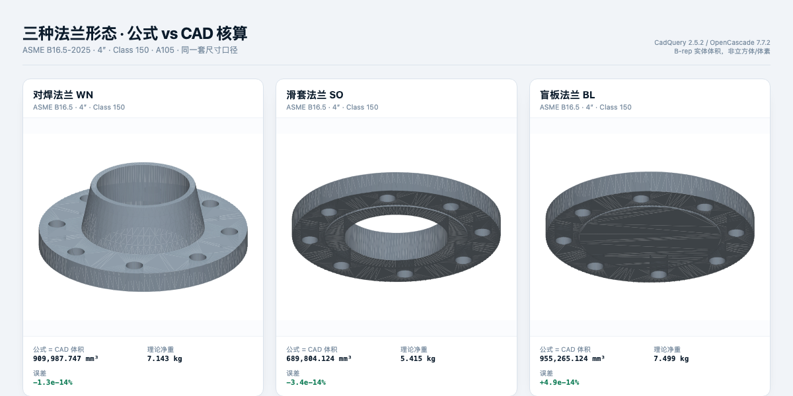

# 三种法兰形态核算 · 4″ Class 150

- 日期：2026-11-06
- 标准：ASME B16.5-2025
- 规格：4″，Class 150，A105
- 口径：C 为数据包归一后的本体厚度（th=22.4，f=1.5，总厚 23.9）；内孔 Sch 40；RF 密封面；直锥台轮毂；螺栓孔
- 工具：CadQuery 2.5.2 + OpenCascade 7.7.2

## 结果

| 形态 | 公式体积 mm³ | CAD 体积 mm³ | 误差 | 公式净重 kg | CAD 净重 kg | 参考重量 kg | 校准后 kg | 结论 |
|---|---:|---:|---:|---:|---:|---:|---:|---|
| 对焊 WN | 909,987.747 | 909,987.747 | -1.3e-14% | 7.143 | 7.143 | 6.800 | 6.812 | PASS |
| 滑套 SO | 689,804.124 | 689,804.124 | -3.4e-14% | 5.415 | 5.415 | 5.900 | 5.634 | PASS |
| 盲板 BL | 955,265.124 | 955,265.124 | +4.9e-14% | 7.499 | 7.499 | 7.700 | 7.449 | PASS |

三种形态全部通过：公式体积与 CAD 实体体积一致到浮点误差量级。

## “参考重量”是什么

这里的“参考重量”是数据包里从公开尺寸-重量表/厂家目录整理的**近似重量**，不是标准强制规定的重量，也不是精确计算值。旧版界面把它叫“标准表”，容易误解。

- 它可能比 CAD 重，也可能比 CAD 轻：
  - 对焊：参考 6.8 kg，CAD 7.143 kg（参考更轻）；
  - 滑套：参考 5.9 kg，CAD 5.415 kg（参考更重）；
  - 盲板：参考 7.7 kg，CAD 7.499 kg（参考略重）。
- 差异来自参考重量的近似口径、取整、以及我们 CAD 的几何假设；
- 公式正确性看“公式 vs CAD”，不是“公式 vs 参考重量”。

## 说明

- 三种形态不是“换公式”，而是同一套体积分解方式：环、轮毂、密封面、内孔、螺栓孔按类型组合；
- 标准表与 CAD 净重的差异（约 -5%、+9%、+3%）来自标准表近似值，不作为公式正确性的判定；
- 校准后重量更接近标准表，但最终仍应以实际过磅/图纸为准；
- 本次未建圆角、焊端坡口、RTJ 环槽；C 口径为数据包归一值。

## 文件

- STEP/STL：`docs/cad/out/asme-b16-5_{weld-neck,slip-on,blind}_dn100_150.step/.stl`
- 3D 对比图：`docs/images/weight-three-types.png`
- 验证脚本：`docs/cad/verify_flange.py`
