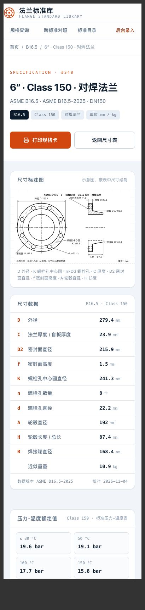
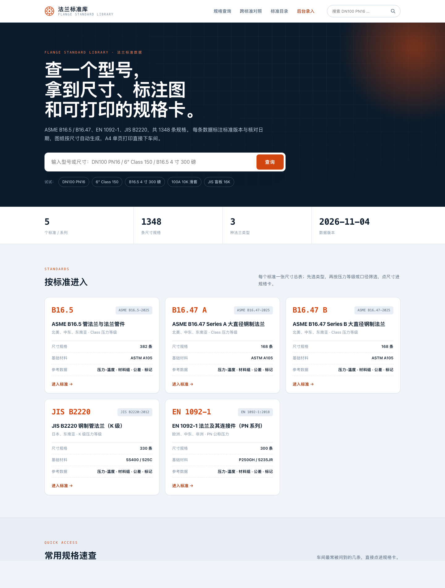
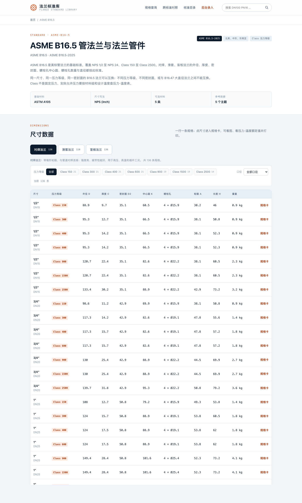
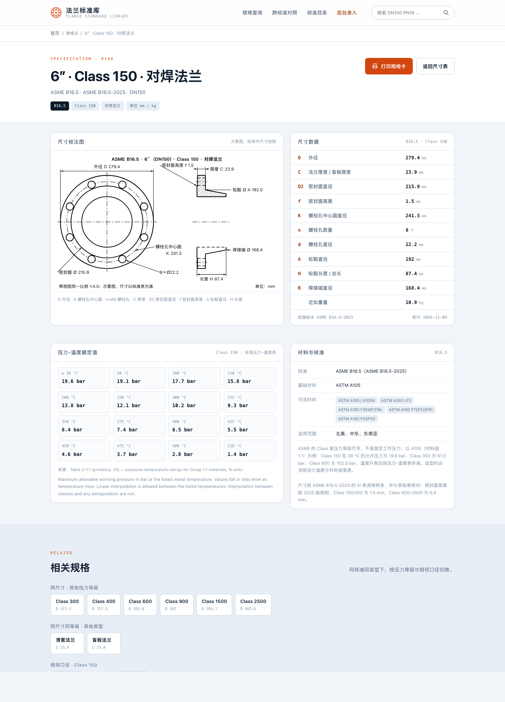
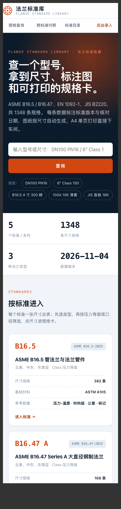
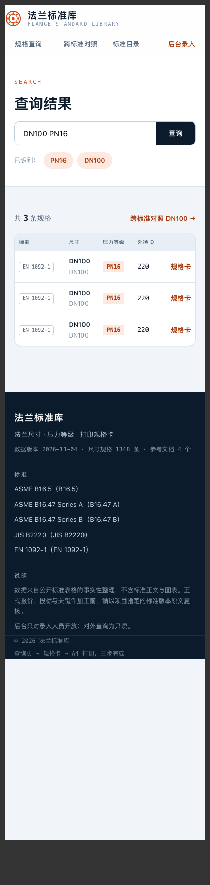
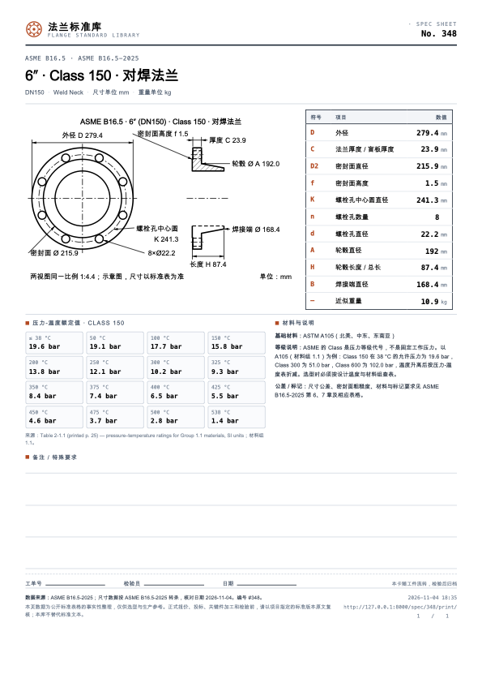
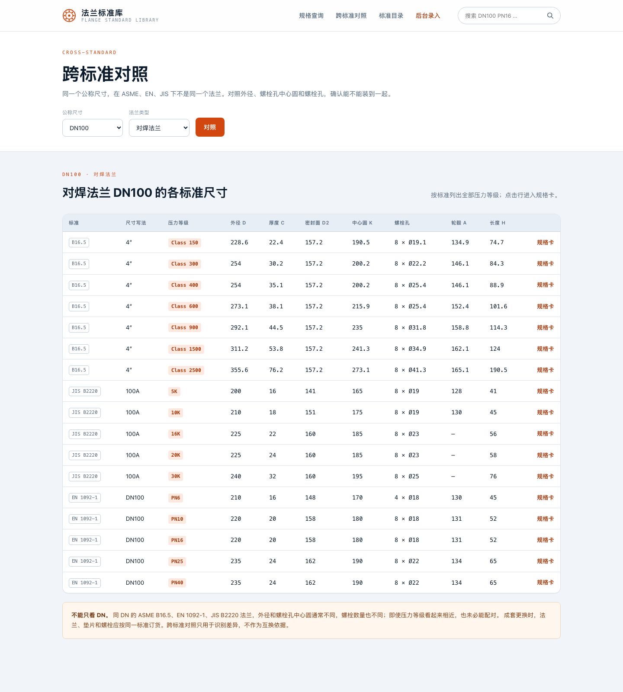
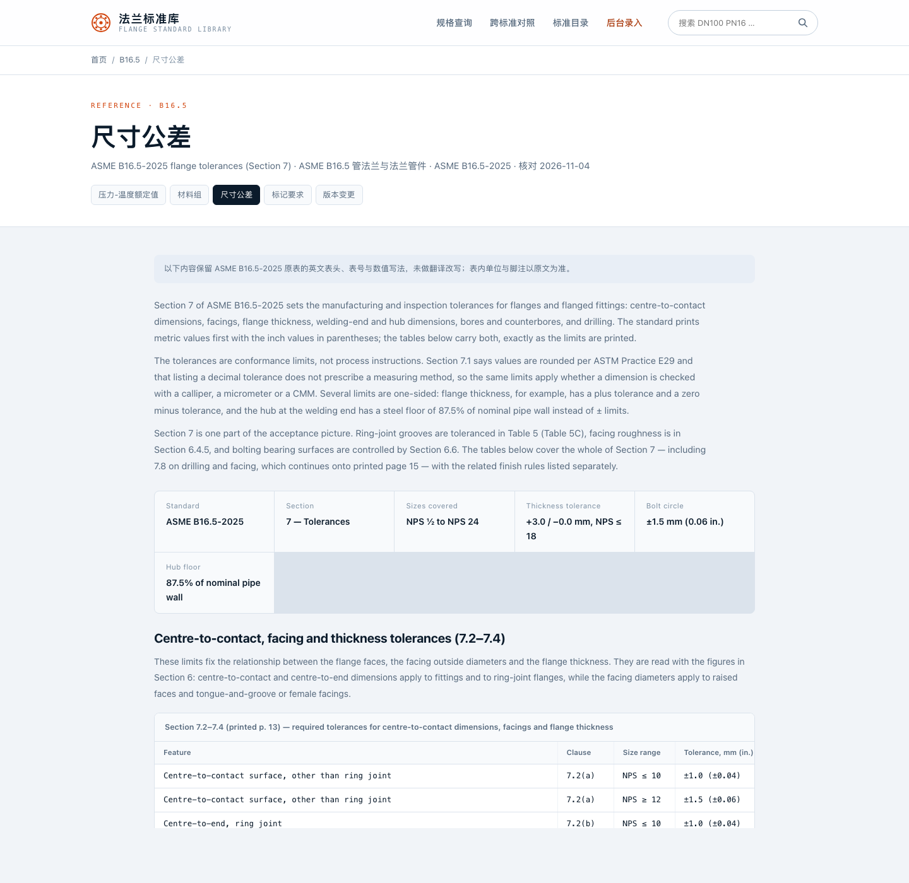
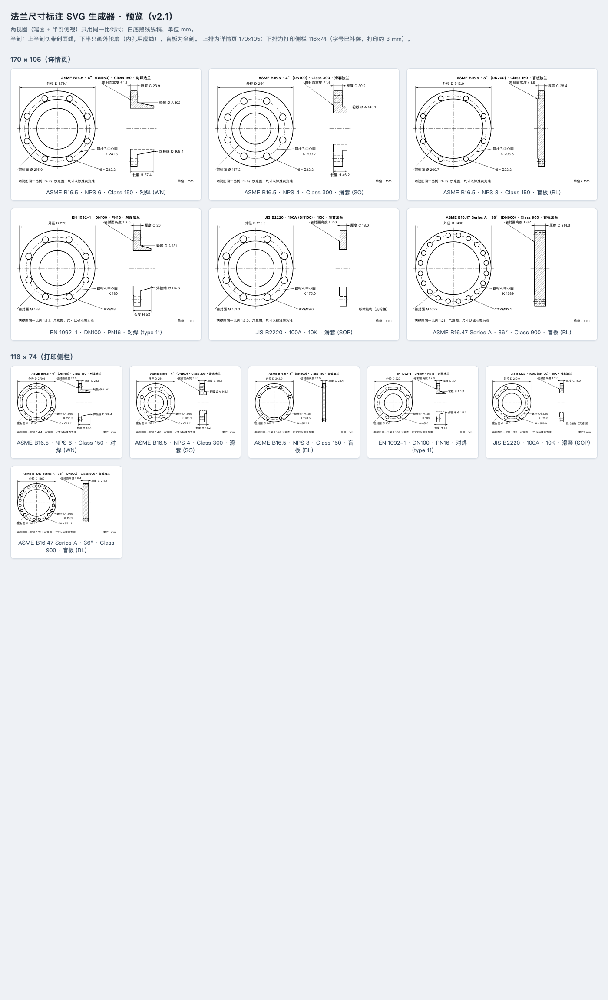

# 法兰标准库 · 设计方案

> 目标：在浏览器里查一个法兰型号，3 步之内拿到「尺寸标注图 + 尺寸数据 + 压力等级说明」，并打印成 A4 单页规格卡，直接下车间。
> 本方案对应的可运行原型已经在本目录实现（Django 4.2 + SQLite），数据来自 `flange-standards-data/`。
> 线上：https://ax-forge.com/std/ （部署细节见 [部署记录](部署记录.md)）。

---

## 1. 一句话方案

**一个「标准 → 类型 → 尺寸 → 压力等级」四层索引的只读查询站 + 一套后台录入 + 一张 A4 规格卡。**

前台只做三件事：**找得到、看得懂、打得出来**；后台只做一件事：**让 1,348 条规格和标准说明可以逐条维护**。

---

## 2. 目标与边界

### 2.1 三个使用场景

| 场景 | 谁在用 | 关键诉求 | 对应设计 |
|---|---|---|---|
| 车间 / 生产 | 班组长、检验、机床操作 | 拿到某个型号的图、尺寸、等级，打印出来贴在工单上 | 规格卡 + A4 单页 + 签核栏 |
| 销售 / 报价 | 业务、技术支持 | 快速确认尺寸、重量、压力等级，跨标准对比 | 搜索 + 跨标准对照 + 重量/压力-温度 |
| 外部客户 | 采购、工程 | 不用问人就能查到数据，建立专业可信度 | 公开只读页面 + 来源/版本/免责声明 |

### 2.2 不做什么（第一期）

- **不做标准全文阅读器**：不收录标准 PDF、正文段落、原图，只整理事实性表格数据。
- **不做 ERP / 报价系统**：不接订单、不接库存；打印页上的「工单号」只是手写栏。
- **不做在线选型计算**：不做管道壁厚、强度校核，只给出标准里印了什么。
- **不做多租户**：一个厂一套库；权限只分「公开查询」和「后台录入」。

---

## 3. 信息架构

### 3.1 站点地图

```
首页 /
├── 搜索 /search/?q=…                    ← 主入口
├── 标准目录 /std/<标准>/
│   ├── 尺寸总表（类型 tab + 等级/口径筛选）
│   └── 参考数据 /std/<标准>/ref/<主题>/
│       ├── 压力-温度额定值
│       ├── 材料组
│       ├── 尺寸公差
│       ├── 标记要求
│       ├── 版本变更
│       └── 类型与密封面
├── 规格卡 /spec/<id>/                   ← 核心页面
│   └── A4 打印页 /spec/<id>/print/
├── 跨标准对照 /compare/?dn=100
└── 后台 /admin/                         ← 仅录入人员
```

### 3.2 查询动线

```
用户输入（"DN100 PN16" / "6″ Class 150" / "B16.5 4 寸 300 磅"）
        │
        ▼
搜索解析：标准 / 类型 / 尺寸 / 压力等级（中文+英文+符号混合）
        │
        ▼
结果列表（40 条/页，按标准→类型→DN→等级排序）
        │
        ▼
规格卡：标注图 + 尺寸表 + 压力-温度 + 材料 + 来源
        │
        ├── 打印规格卡（A4，单页）
        └── 相关规格：同尺寸其他等级 / 同尺寸其他类型 / 相邻口径
```

---

## 4. 页面设计

### 4.1 首页

- **首屏就是搜索框**，不是公司介绍；placeholder 直接给三种写法示例。
- 搜索框下方是 5 个可点击的示例词，降低「不知道该输什么」的门槛。
- 统计条：标准数 / 规格数 / 类型数 / 数据版本，让人一眼知道数据规模和版本。
- 标准卡片：标准号、中文名、版本、地区、规格数、基础材料、参考数据主题。
- 常用规格速查：6 条最常被问到的规格，直接点进规格卡。
- 「查询 → 查看 → 打印」三步说明 + 数据边界声明。

### 4.2 搜索页

- 解析结果以「已识别」标签显示（如 `ASME B16.5`、`Class 150`、`6″ / DN150`），让用户知道系统理解了什么。
- 结果表列：标准、类型、尺寸、压力等级、外径 D、厚度 C、中心圆 K、螺栓孔、重量、规格卡入口。
- 空结果时给 4 种可复制的写法示例，而不是只说「没有结果」。

支持的输入写法：

| 输入 | 解析结果 |
|---|---|
| `DN100 PN16` | DN100 + PN16（EN） |
| `6″ Class 150` | DN150 + Class 150（ASME） |
| `B16.5 4 寸 300 磅` | ASME B16.5 + DN100 + Class 300 |
| `100A 10K 滑套` | DN100 + 10K + 滑套（JIS） |
| `B16.47 36 英寸 900 磅` | ASME B16.47 A/B + DN900 + Class 900 |
| `2-1/2"` | DN65 |

### 4.3 标准页

- 一个标准一张尺寸总表，按**类型 tab**（对焊 / 滑套 / 盲板）拆开，避免 300+ 行一屏灌下来。
- 二级筛选：压力等级 chips + 口径下拉；显示当前条数。
- 表格列覆盖 D、C、D2、K、n×d、A、H、重量，点尺寸进规格卡。
- 页面底部：参考数据入口 + 压力等级说明 + 版本核对说明。

### 4.4 规格卡（核心页面）

左右两栏：

```
┌───────────────────────────────┬──────────────────────┐
│  尺寸标注图（服务端 SVG）       │  尺寸数据表            │
│  - 端面视图：D / K / n×d / RF  │  D 外径       279.4 mm │
│  - 剖视图：C / f / A / H / 焊接端│ C 厚度        23.9 mm │
│  - 比例尺、单位、示意图声明      │ K 中心圆      241.3 mm │
│                               │ n×d 螺栓孔    8 × Ø22.2│
│                               │ …                     │
├───────────────────────────────┴──────────────────────┤
│  压力-温度额定值（按等级/材料组）  │  材料与标准说明       │
├──────────────────────────────────────────────────────┤
│  相关规格：同尺寸其他等级 / 同尺寸其他类型 / 相邻口径   │
└──────────────────────────────────────────────────────┘
```

- 右上角固定「打印规格卡」主按钮。
- 数据版本、核对日期、规格编号在页面上可见，打印页也带。

### 4.5 A4 打印页（核心页面）

`/spec/<id>/print/` 是独立的 A4 版面，不继承站点导航，浏览器直接打印或「保存为 PDF」。

版面（210 × 297 mm，内边距约 11–12 mm）：

```
┌──────────────────────────────────────────────────────┐
│ 法兰标准库 logo            规格卡 · SPEC SHEET  No.348 │
│──────────────────────────────────────────────────────│
│ ASME B16.5 · ASME B16.5-2025                          │
│ 6″ · Class 150 · 对焊法兰          ← 主标题（最大字）  │
│ DN150 · Weld Neck · 尺寸单位 mm                        │
│──────────────────────────────────────────────────────│
│ ┌──────────────────────┐  ┌─────────────────────────┐ │
│ │                      │  │ 符号 项目          数值  │ │
│ │   尺寸标注图          │  │ D  外径         279.4 mm │ │
│ │   （端面+剖视）        │  │ C  厚度          23.9 mm │ │
│ │                      │  │ …                       │ │
│ └──────────────────────┘  └─────────────────────────┘ │
│──────────────────────────────────────────────────────│
│ ■ 压力-温度额定值（4×4 紧凑网格） │ ■ 材料与说明         │
│──────────────────────────────────────────────────────│
│ 工单号 ____  检验员 ____  日期 ____    本卡随工件流转  │
│──────────────────────────────────────────────────────│
│ 数据来源/版本/核对日期/编号         打印时间/URL/页码  │
│ 免责声明（小字）                                       │
└──────────────────────────────────────────────────────┘
```

打印设置（页面工具条直接提示）：A4、纵向、边距默认/无、关闭浏览器页眉页脚、缩放 100%。

**A4 样例**：[样例-规格卡-A4.pdf](样例-规格卡-A4.pdf)（已用 Chromium 打印引擎验证为 1 页）。

**手机打印**：iPhone Safari 不支持 `window.print()`，打印页提供「下载 PDF」按钮，
由服务端 Playwright + Chromium 渲染同一张 A4 规格卡（`/spec/<id>/pdf/`），手机可直接保存或分享。

打印页的三条设计原则：

1. **黑白可读**：只依赖线宽、字号、留白，不依赖底色；激光打印机直接出。
2. **单页**：所有内容控制在一页内，不出现「第 2 页只有一行字」。
3. **可追溯**：页脚固定带标准版本、核对日期、规格编号、打印时间、URL。

### 4.6 跨标准对照

- 选 DN + 类型，列出 ASME / EN / JIS 同口径的全部压力等级。
- 表格并列 D、C、D2、K、n×d，差异一眼可见。
- 底部固定提示：**不能只看 DN**，同 DN 不同标准的外径和螺栓孔通常不同，跨标准对照只用于识别差异，不作为互换依据。

### 4.7 手机 / 平板适配

同一个站点自适应，不做单独的移动端站点或 App：

- **导航**：手机上品牌与主导航分成两行，四个入口全部可见，不再横向挤压。
- **表格**：结果表、标准尺寸表、对照表在手机上只保留主列（尺寸、等级、外径/厚度、操作），次要列（类型、密封面、中心圆、螺栓孔、重量）自动隐藏；桌面端仍显示全列。
- **规格卡**：图与尺寸表上下堆叠，尺寸表整行展示；压力-温度从 4 列降为 2 列。
- **打印页**：手机浏览器同样可以打开 A4 打印页，通过系统打印（AirPrint）或「保存为 PDF」输出；正式批量打印仍建议桌面浏览器。
- **图纸**：手机上是缩放后的矢量图，双指放大不糊；需要看细节时可以横屏或放大页面。

实测宽度：390 px（iPhone 14 / 主流安卓）与 360 px 均无横向滚动、无内容截断。



### 4.8 参考数据页

- 按主题渲染参考数据：压力-温度表、材料组、公差、标记、版本变更、类型与密封面。
- 表格保留标准原表的**表号、页码、脚注、小数逗号、`—` 空值**，不做二次加工。
- 页面顶部说明：保留英文原表头与数值写法，不翻译改写。

---

## 5. 数据设计

### 5.1 数据源

`flange-standards-data/` 是独立数据包：

| 内容 | 文件 | 规模 |
|---|---|---|
| 标准元数据 | `data/standards.json` | 5 个标准/系列 |
| 尺寸数据 | `data/dimensions/*.json` | 1,348 行 |
| 参考数据 | `data/reference/*.json` | 4 个文档、20 个主题、60 张表 |
| 查询库 | `sqlite/flange-standards.sqlite` | 可直接 SQL 查询 |
| 校验 | `scripts/validate.py` | 结构/行数/校验和/SQLite 完整性 |

### 5.2 数据模型（Django ORM）

```
Standard (id=slug)
 ├── name / name_zh / edition / dimension_edition
 ├── region / rating_name / size_syntax / base_material / material_options
 ├── intro_zh / rating_note_zh / edition_note_zh
 ├── reference_doc_id ──────────────► ReferenceDoc (id, edition, verified_on, payload JSON)
 └── ratings ───────────────────────► Rating (code, label, sort_order)

FlangeType (slug=weld-neck/slip-on/blind)
 └── name_zh / name_en / note_zh

DimensionRow  ← 核心表，一行 = 标准 + 类型 + 尺寸 + 压力等级
 ├── FK standard / flange_type / rating
 ├── size / size_label / dn
 ├── od / th / rf / rf_height / bc / bolts / bolt_hole
 └── hub / length / hub_weld / weight
 UNIQUE(standard, flange_type, size, rating)
 INDEX(standard, flange_type, rating, dn)

DataImport  ← 每次导入的版本、行数、时间，用于页面展示与审计
```

### 5.3 关键设计决策

| 决策 | 选择 | 理由 |
|---|---|---|
| 一行一规格 | `DimensionRow` 一格一值 | 查询/打印都按一条记录渲染，避免运行时拼表 |
| 尺寸字段用数值 | mm / kg，`NULL` 表示标准未列 | 能用、能算、能比较；空值不当 0 |
| 参考数据保留 JSON | `ReferenceDoc.payload` 原样保存 | 标准表有合并单元格、脚注、小数逗号，拆碎会丢信息 |
| 压力-温度单独解析 | `pt.py` 只读成「温度 → 允许压力」序列 | 打印页能放紧凑表，页面能按等级显示 |
| 版本字段分两层 | `edition`（参考数据）+ `dimension_edition`（尺寸） | 尺寸与参考数据可能来自不同版本 |
| 唯一键 | 标准+类型+尺寸+等级 | 重复导入幂等；跨标准同 DN 允许并存 |

### 5.4 后台录入规范

- 尺寸字段单位固定 mm，重量 kg；标准未列留空，**不要填 0**。
- `size` 是 URL 键，保持稳定（如 `1-2`、`dn100`、`100a`），改它会改变链接。
- 新标准：先建 `Standard`，再建 `Rating`，再录 `DimensionRow`；参考数据由导入命令导入。
- 每次批量改数据后重新跑 `import_standards` 或 `validate.py`，避免手工录错。

---

## 6. 图纸生成方案

### 6.1 为什么用服务端 SVG

- **打印清晰**：矢量图，A4 下任意放大不糊；PNG 在 600 dpi 下容易发虚。
- **随规格变化**：同一套代码按每行的 D/K/n×d/C/A/H 生成，不需要 1,348 张静态图。
- **可内嵌**：`{{ svg|safe }}` 直接进页面，不需要图片请求；打印时同步加载。
- **可降级**：生成失败时页面显示「图暂缺」，不影响数据与打印按钮。

### 6.2 两个视图

| 视图 | 画什么 | 标什么 |
|---|---|---|
| 端面视图 | 外圆 D、螺栓孔中心圆 K（点划线）、n 个均布孔、密封面 RF、内孔 | D、K、n×Ød、RF Ø |
| 剖视图（半剖） | 上半剖切并画 45° 剖面线：法兰盘厚度 C、密封面凸台 f、轮毂 A/H、对焊端；下半画外轮廓、内孔用虚线 | C、f、A、H、焊接端 Ø |

- 盲板：无轮毂、无内孔，只画圆盘 + 密封面凸台 + 厚度。
- 数据缺失（EN/JIS 部分类型无轮毂、JIS 滑套无轮毂）自动省略对应图形和标注。
- 两个视图共用同一比例尺，图下方标注比例（如 `1:4.9`）和「示意图，不按比例用于检验」。

### 6.3 缩放与兜底

- 调用参数 `width_mm / height_mm`：详情页 170×105，打印页 116×74，按版面选比例。
- 极小规格（1/2″）和极大规格（B16.47 60″）都按外径自动缩放。
- 图中文字 3.2–4 mm，线宽 0.3–0.65 mm；黑白、无渐变。

---

## 7. 打印方案

### 7.1 为什么是 A4 单页

- 车间现有打印机默认 A4；A3 不是所有工位都有。
- 一张卡对应一个型号，方便贴工单、随工件流转。
- 单页强制把「最重要的信息」压缩：图、尺寸、等级、材料、来源。

### 7.2 打印设置的坑

- 浏览器默认会加**页眉页脚**（URL、日期、页码），必须提示关闭。
- 缩放不要用「适合页面」，用 100%，否则 mm 尺寸会失真。
- `@page { size: A4; margin: 0 }` + 纸张内边距，避免打印机物理边距裁切。
- 页面工具条固定提示：A4 · 纵向 · 边距默认/无 · 关闭页眉页脚 · 100%。

### 7.3 实现时踩过的坑（已验证）

在 Chromium / Chrome 打印引擎上实测，有三点会直接影响「能不能一页打出来」：

1. **移动端断点必须加 `screen and`**。A4 纸在 96 dpi 下宽 794 px，如果写 `@media (max-width: 820px)`，打印时也会命中，页面会按手机单栏排版，A4 直接变两页。正确写法：`@media screen and (max-width: 820px)`。
2. **打印字体要能被 PDF 嵌入**。Chromium 导出 PDF 时，`PingFang SC` 这类 TTC 系统字体可能显示为空白；打印样式字体栈里放一个可嵌入的 TTF（如 `Arial Unicode MS` / Noto Sans CJK）作为首选，中文才能稳定出现在 PDF 里。
3. **图片/SVG 高度要显式约束**。内联 SVG 在分页媒体里可能按固有尺寸参与布局，`@media print` 里给图区固定高度（如 `height: 78mm`）并让 `svg { width:100%; height:100% }`，避免把 footer 挤到第二页。

验证方法：`chromium --headless --print-to-pdf` 后读取 PDF 页数（pypdf），5 类规格（ASME WN / ASME 滑套 / ASME 盲板 / EN / JIS / B16.47 大直径）均为 1 页。

### 7.4 服务端 PDF（手机打印）

- 端点：`/spec/<id>/pdf/`，用 Playwright 驱动 Chromium 打开内部打印页 `https://127.0.0.1/std/spec/<id>/print/`；
- 输出 A4 PDF（`prefer_css_page_size=True`），与桌面打印完全一致；
- 首次约 6–7 秒，之后按 `row.updated_at` 缓存到 `/var/lib/flange-std/pdf/`；
- 改了打印样式后把环境变量 `PDF_LAYOUT_VERSION` +1，强制重新生成。

### 7.5 后续增强

- **批量打印**：按筛选结果一次生成多张规格卡（一页一张，或一页 2×2 缩略卡）。
- **二维码**：打印页放详情 URL 二维码，手机扫码回查；需要引入轻量二维码库。
- **PDF 归档**：部署时用 Playwright/Chromium 生成 PDF，替代人工「打印为 PDF」。

---

## 8. 技术架构与部署

### 8.1 选型理由

| 层 | 选型 | 理由 |
|---|---|---|
| Web 框架 | Django 4.2 LTS | 自带 Admin（录入零开发）、ORM、迁移、权限、中文 i18n |
| 数据库 | SQLite → PostgreSQL | 1,348 行 SQLite 足够；并发大或要备份策略时切 PG，只改配置 |
| 页面 | Django 模板 + 原生 CSS | 服务端渲染，打印稳定；不引入前端框架的构建和 hydration |
| 图纸 | 服务端 SVG | 见 §6 |
| 部署 | Nginx + Gunicorn | 单机即可；静态文件 Nginx 直接服务 |

### 8.2 部署拓扑

```
浏览器
  │ HTTPS
  ▼
Nginx ── /static/ ──► staticfiles/
  │
  └── / ──► Gunicorn (127.0.0.1:8001)
              └── Django ── SQLite / PostgreSQL
```

- 公网只暴露查询页面；`/admin/` 用 Nginx `allow/deny` 限制到公司 IP 或 VPN。
- 具体服务器配置、部署脚本、HTTPS、备份与验收清单见 [部署指南](部署指南.md)；
  本次实际部署见 [部署记录](部署记录.md)。
- 数据包不入库也能查（CSV/SQLite），但页面查询走 Django 数据库，读多写少。

### 8.3 安全与权限

- 公开页面只读，无登录、无写入接口。
- 后台用 Django 账号 + 强密码；上线前改掉演示账号，关闭 `DEBUG`。
- 打印页不暴露内部备注字段；数据来源与免责声明固定显示。
- 定期备份 `db.sqlite3`（或 PG dump）+ 数据包目录。

### 8.4 性能

- 1,348 行数据量很小，单页查询有索引，无需缓存。
- 首页统计和标准列表可加 5 分钟缓存；参考数据 JSON 较大（约 1 MB），可缓存页面。
- 图纸是字符串拼接，单张 < 10 ms。

---

## 9. 数据维护流程

```
标准更新 / 发现错漏
      │
      ▼
修改 flange-standards-data/data/**
      │
      ▼
python3 scripts/validate.py          ← 结构、行数、校验和、SQLite 完整性
      │
      ▼
python manage.py import_standards    ← 幂等覆盖 + 写导入日志
      │
      ▼
抽查规格卡 + 打印页 → 发布
```

- 数据包是「单一事实来源」；Django 数据库是它的投影。
- 后台适合改单条、补备注；**大批量改动回到数据包改，再导入**。
- `DataImport` 记录版本、行数、导入时间，页面显示，便于追溯「这张卡是哪版数据打的」。

---

## 10. 路线图

| 阶段 | 内容 | 状态 |
|---|---|---|
| **v1（本次）** | 法兰 4 标准查询、SVG 标注图、A4 打印、后台录入、跨标准对照、参考数据页 | ✅ 原型完成 |
| v1.1 | 参考数据中文化；二维码；批量打印；打印页公差摘要；搜索结果高亮 | 建议下一步 |
| v1.2 | 多语言（中/英）；客户可下载 PDF；访问统计（哪些型号被查最多） | |
| v2 | 扩展品类：管件、紧固件、阀门、钢材；数据模型沿用 `Standard + 类型 + 规格` | |
| v2.1 | 材料库、垫片/螺栓匹配、跨品类对照 | |
| v3 | 内部 API、PWA 离线、企业微信/钉钉入口、与 ERP 工单联动 | |

---

## 11. 已知限制与风险

| 限制 | 影响 | 处理 |
|---|---|---|
| 参考数据仍是英文 | 车间看公差/标记表有门槛 | v1.1 翻译表头与说明，数值保留原文 |
| 标注图是示意图 | 不能当检验图使用 | 图上明确写「不按比例用于检验」；检验以标准原文为准 |
| 压力-温度只取材料组 1.1 | 其他材料组需查参考页 | 规格卡给出链接；v1.1 支持材料组切换 |
| 标准版权 | 不能收录标准正文/PDF | 只做事实性数据；注明来源与免责；采购正版标准 |
| 数据准确性 | 转录错误可能导致生产问题 | 数据包逐格核对 + 校验脚本 + 打印页版本/日期 |
| SQLite 并发 | 多人同时写入会锁 | 公开只读；录入人少；需要时切 PostgreSQL |

---

## 12. 验收清单

- [x] 5 个标准/系列、1,348 行尺寸导入成功
- [x] 搜索支持 DN / NPS / A 数、Class / PN / K、对焊/滑套/盲板、标准号
- [x] 规格卡显示标注图、尺寸表、压力-温度、材料、来源
- [x] A4 打印页单页输出，含来源、核对日期、免责声明、签核栏
- [x] 后台可筛选、搜索、逐条编辑尺寸规格
- [x] 参考数据页保留原表号、页码、脚注
- [x] 跨标准对照页
- [x] 手机 390 px / 360 px 宽度下可查询、看图、打开打印页
- [ ] 参考数据中文化（v1.1）
- [ ] 批量打印 / 二维码（v1.1）

---

## 附录 A：本机运行

```bash
cd /Users/manshu/网站/标准库
./.venv/bin/python manage.py runserver 127.0.0.1:8000
```

详见 [README.md](../README.md)。

## 附录 B：页面截图

| 页面 | 截图 |
|---|---|
| 首页 |  |
| 标准页 |  |
| 规格卡 |  |
| 手机端规格卡（390 px） |  |
| 手机端首页（390 px） |  |
| 手机端搜索结果（390 px） |  |
| A4 打印页（PDF 渲染） |  |
| 跨标准对照 |  |
| 参考数据 |  |
| 标注图预览（12 张） |  |

单页打印样例：[样例-规格卡-A4.pdf](样例-规格卡-A4.pdf)
